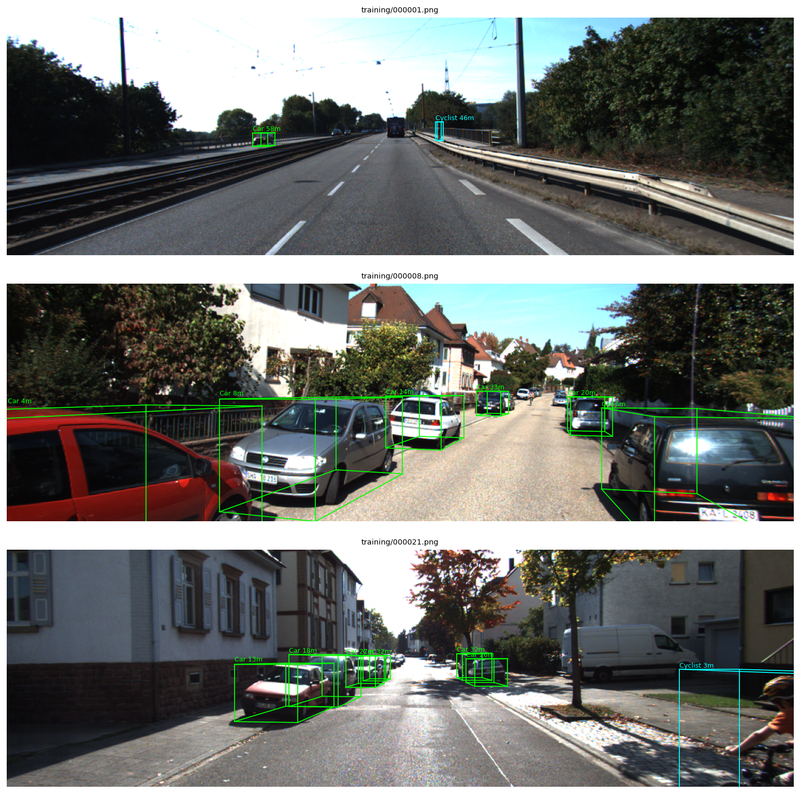
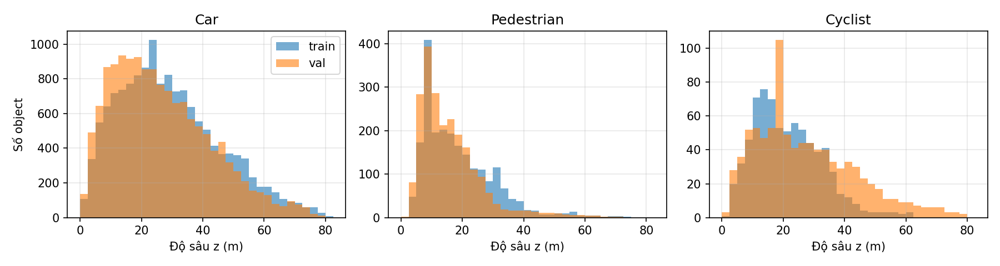

# A2 – Monocular 3D Object Detection trên KITTI (MonoCoP)

Mốc hiện tại: **A2.1 – chủ đề + paper + dữ liệu**. Pipeline, so sánh biến thể và phân tích paper đầy đủ sẽ có ở A2.2 (16/11/2026).

## Chủ đề
Phát hiện đối tượng 3D từ **một ảnh RGB** (monocular 3D object detection, Mono3D): với mỗi object, dự đoán lớp, box 2D trên ảnh và box 3D trong hệ tọa độ camera (tâm (x, y, z), kích thước (h, w, l), góc quay ry quanh trục đứng). Chủ đề thuộc nhóm *phát hiện đối tượng* trong đề (KITTI có trong danh sách gợi ý). Đây không phải phân loại ảnh như A1: model phải định vị object trong không gian 3D, trong đó khó nhất là ước lượng độ sâu từ một ảnh.

## Paper phân tích
Zhihao Zhang, Abhinav Kumar, Girish Chandar Ganesan, Xiaoming Liu. **Unleashing the Power of Chain-of-Prediction for Monocular 3D Object Detection**. CVPR 2026 (Highlight), trang 18755–18765. [arXiv:2505.04594](https://arxiv.org/abs/2505.04594) · code chính thức: [alanzhangcs/MonoCoP](https://github.com/alanzhangcs/MonoCoP).

```bibtex
@inproceedings{zhang2026monocop,
  title     = {Unleashing the Power of Chain-of-Prediction for Monocular 3D Object Detection},
  author    = {Zhang, Zhihao and Kumar, Abhinav and Ganesan, Girish Chandar and Liu, Xiaoming},
  booktitle = {Proceedings of the IEEE/CVF Conference on Computer Vision and Pattern Recognition (CVPR)},
  year      = {2026}
}
```

Ý chính (tóm tắt sơ bộ, phân tích đầy đủ ở A2.2):
- **Nhận xét.** Qua phép chiếu phối cảnh, độ sâu, kích thước 3D và góc quay cùng quyết định hình dạng object trên ảnh. Một xe nhỏ ở gần và một xe lớn ở xa có thể trông giống nhau. Phần lớn detector trước đó dự đoán các thuộc tính này song song và độc lập với nhau. Paper đo trên MonoDETR: sai số độ sâu tương quan với sai số kích thước (r = 0.35) và với sai số góc (r = 0.11).
- **Chain-of-Prediction (CoP).** Từ mỗi object query của decoder, ba MLP hai lớp lần lượt tạo đặc trưng cho kích thước, góc và độ sâu theo chuỗi size → angle → depth. Mỗi bước có kết nối residual nối với bước trước, để tránh lỗi tích lũy như khi dự đoán tuần tự trên output.
- **Uncertainty-Guided Selector (GS).** Độ sâu được mô hình hóa theo phân phối Laplace, có dự đoán uncertainty (loss kiểu GUP Net). Khi suy luận, với mỗi object, nếu uncertainty của nhánh chain đủ thấp thì dùng nhánh chain, ngược lại dùng nhánh dự đoán song song.
- **Kiến trúc nền.** MonoDGP/MonoDETR gồm backbone ResNet-50, depth predictor, encoder và decoder Transformer kiểu deformable DETR với 50 query, và Hungarian matching. Toàn bộ model được train trên KITTI trong 250 epoch.
- **Kết quả paper trên KITTI val (Car, AP3D|R40, IoU 0.7).** MonoCoP đạt Easy/Moderate/Hard 32.06 / 23.98 / 20.64 (median của 5 run), so với 30.76 / 22.34 / 19.02 của MonoDGP. Ablation (Tab. 5a): baseline đạt Moderate 21.12, thêm CoP được 23.64, thêm cả GS được 23.98.

Một số điểm cần kiểm chứng ở A2.2, ghi nhận khi đọc code chính thức (`lib/models/monocop/monocop.py`):
- Chỉ độ sâu có hai nhánh (chain và parallel). Kích thước và góc luôn đi theo nhánh chain.
- Khi train, nhánh được chọn **ngẫu nhiên** theo nhóm query với xác suất 0.5 (`groupwise_random_route`), không dựa vào uncertainty.
- Khi suy luận, nhánh chain được chọn nếu log-variance của độ sâu nhỏ hơn `uncertainty_tau = 5` (trong paper là ngưỡng trên độ tin cậy 1/σ).
- Checkpoint "best" được chọn theo AP trên chính tập val dùng để báo cáo, nên con số có thể lạc quan.

## Dữ liệu: KITTI 3D Object Detection
- Geiger, Lenz, Urtasun. *Are we ready for autonomous driving? The KITTI vision benchmark suite*. CVPR 2012. Trang dataset: https://www.cvlibs.net/datasets/kitti/eval_object.php?obj_benchmark=3d
- Dùng ảnh camera màu trái (`image_2`), ma trận chiếu `P2` trong `calib/` và nhãn 3D trong `label_2/`. Không dùng LiDAR hay dữ liệu bổ sung, giống thiết lập "None" của paper.
- License: CC BY-NC-SA 3.0, chỉ dùng cho học thuật. Repo không phân phối lại ảnh.
- Split train/val theo Chen et al. (CVPR 2016), như paper và các phương pháp Mono3D khác. Tập test có nhãn ẩn và chỉ đánh giá qua server của KITTI; A2 không nộp lên server này.

| Tập | Số ảnh | Car | Pedestrian | Cyclist | Ghi chú |
|---|---|---|---|---|---|
| train | 3,712 | 14,357 | 2,207 | 734 | huấn luyện |
| val | 3,769 | 14,385 | 2,280 | 893 | chọn checkpoint và báo cáo (như paper) |
| test | 7,518 | – | – | – | nhãn ẩn, không dùng |

Thống kê từ `python eda.py` (`outputs/eda.json`):
- Ảnh có kích thước khoảng 1242×375; có 4 kích thước khác nhau do hiệu chỉnh camera ở từng ngày ghi (6,057 ảnh 1242×375). Ngoài ba lớp đánh giá còn có Van, Truck, Tram, Misc, Person_sitting và vùng DontCare.
- Lớp Car chiếm đa số (14,357 xe trong train, khoảng 4 xe/ảnh). Pedestrian ít hơn 6.5 lần và Cyclist ít hơn 20 lần. Vì vậy A2 tập trung vào **Car** (cấu hình `monocop_car.yaml` của tác giả), là thước đo chính trong paper.
- Độ sâu của Car trong train có median 27.0 m và p95 60.5 m; 24.6% số xe ở xa từ 40 m trở lên. Đây là vùng mà paper cho rằng CoP giúp nhiều nhất. Val có phân phối gần giống (median 24.0 m, 20.5% xe ở xa từ 40 m).
- Mức khó theo quy tắc của KITTI, dựa trên chiều cao box 2D, mức che khuất và mức bị cắt:
  - Easy: box cao ≥ 40 px, không bị che, bị cắt ≤ 15%.
  - Moderate: box cao ≥ 25 px, bị che một phần, bị cắt ≤ 30%.
  - Hard: box cao ≥ 25 px, bị che nhiều, bị cắt ≤ 50%.

  Xếp mỗi xe trong train vào mức dễ nhất mà nó thỏa: Easy 3,064, Moderate 4,770, Hard 2,919, và 3,604 xe không thỏa mức nào (bị bỏ qua khi tính AP). Lưu ý khi tính AP, các mức là lũy tiến: Moderate tính cả object Easy.





Các hình khác: `outputs/figs/class_counts.png`, `outputs/figs/difficulty.png`.

### Tiền xử lý và augmentation (theo code MonoCoP, sẽ giữ nguyên ở A2.2)
- Ảnh được affine-transform về 1280×384 và chuẩn hóa theo mean/std của ImageNet.
- Photometric distortion kiểu SSD (`aug_pd`): độ sáng, độ tương phản, độ bão hòa, sắc độ.
- Lật ngang với xác suất 0.5: nhãn 3D và calib được cập nhật tương ứng.
- Random crop với xác suất 0.5: scale trong khoảng 1 ± 0.05 và shift tối đa ±10% kích thước ảnh. Nhãn độ sâu được nhân với tỉ lệ scale (`depth_scale: normal`).
- Mixup 3D với xác suất 0.3 (trộn với một ảnh train khác).
- Val/test chỉ resize, không augmentation. Batch 16.

## Metric
- **Chính:** AP3D|R40 của lớp Car với IoU 3D ≥ 0.7, ở mức Moderate. Đây là metric xếp hạng của KITTI; R40 là trung bình precision tại 40 mức recall (Simonelli et al., ICCV 2019).
- **Phụ:**
  - AP3D và APBEV ở cả ba mức Easy/Moderate/Hard, với IoU 0.7 và 0.5.
  - AP 2D và AOS, có sẵn từ evaluator chính thức.
- **Phân tích lỗi:** sai số tuyệt đối trung bình (MAE) của độ sâu, kích thước và góc, chia theo khoảng cách (như Fig. 4 của paper), tính trên các object được match với ground truth.
- **Chi phí:** số tham số, thời gian train, FPS khi suy luận.

## Kế hoạch pipeline (A2.2)
Dùng code chính thức tại commit `7d39324` của `alanzhangcs/MonoCoP`, kèm vài bản vá build cho CUDA 12.1/A100. Kinh nghiệm cài đặt nằm trong `lesson.md` của bản clone. Chạy trên A100 80GB, mỗi run một GPU.

Các biến thể so sánh (đề yêu cầu ít nhất hai):
1. **MonoCoP đầy đủ (CoP + GS):** tái hiện với `config/monocop_car.yaml`, 250 epoch, lr 2e-4, step decay. Chạy nhiều seed và báo cáo median như paper.
2. **Baseline dự đoán song song (không CoP, không GS):** kích thước, góc và độ sâu đều dự đoán trực tiếp từ object query, giống MonoDGP. Cần thêm một cờ config vào `monocop.py`. Cùng recipe và cùng số epoch với biến thể 1.
3. **Ablation chọn nhánh khi suy luận** (không cần train lại), trên checkpoint của biến thể 1: luôn dùng chain, luôn dùng parallel, GS với `uncertainty_tau` mặc định, và quét ngưỡng `tau`. Đo thêm tỉ lệ object được chuyển sang nhánh chain. Phần này giúp kiểm tra luận điểm "GS chọn nhánh tốt hơn chọn cố định".
4. *Mở rộng nếu còn thời gian:* MAE theo khoảng cách cho biến thể 1 và 2; đánh giá độ bền trên KITTI-C (ảnh val bị nhiễu, mờ, sương mù và các corruption khác, đã có sẵn trên máy).

Kết quả sơ bộ: bản clone đã train biến thể 1 bốn lần (seed 444, 250 epoch, khoảng 14.7 giờ/run trên một A100). Best checkpoint đạt AP3D|R40 Car Moderate 23.06 / 23.55 / 23.80 / 23.95, so với 23.98 trong paper và 24.05 trong README của tác giả với cấu hình Car. Nguồn là `outputs/monocop_car/*/train.log.*` của bản clone. Ở A2.2, các con số này sẽ được kiểm tra lại, báo cáo đủ Easy/Hard và so với baseline.

Thời gian ước tính cho A2.2: khoảng 15 giờ/run. Ba seed cho biến thể 2 và thêm seed cho biến thể 1 cần khoảng 2 ngày trên 2 × A100. Ablation suy luận mất vài phút mỗi cấu hình.

## Cách chạy
    python eda.py --root /path/to/KITTI    # thống kê -> outputs/eda.json, hình -> outputs/figs/

KITTI root cần có `ImageSets/{train,val}.txt` và `training/{image_2,label_2,calib}/` (cấu trúc của MonoCoP/MonoDGP). Script chỉ cần numpy, matplotlib và Pillow từ `requirements.txt` ở gốc repo.
