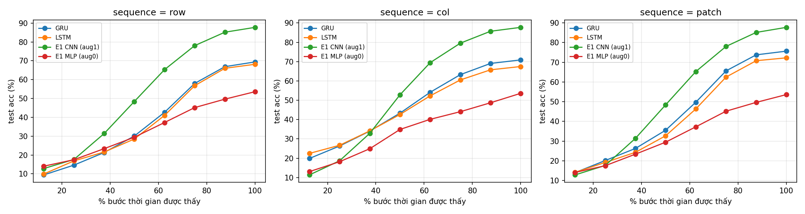

# E3 – LSTM / GRU trên ảnh dạng chuỗi (CIFAR-10)

## Mục tiêu
Mô hình hóa ảnh CIFAR-10 như một chuỗi và phân loại bằng LSTM, GRU (`nn.LSTM`, `nn.GRU`); so sánh ba cách đưa ảnh thành chuỗi, LSTM vs GRU, và với baseline không hồi quy MLP/CNN của E1 (cùng split).

## Dữ liệu
Giống E1/E2: CIFAR-10, train 40,000 / val 10,000 (`split_seed=912`) / test 10,000. Chuẩn hóa mean/std theo kênh, augmentation RandomCrop(32, padding=4) + RandomHorizontalFlip cho train. Test chỉ dùng một lần ở cuối, chọn checkpoint theo val accuracy.

## Biểu diễn ảnh thành chuỗi
`models.py: ImageToSequence` (không có tham số), ảnh [3, 32, 32] → chuỗi [T, F]:

| Cách | Mỗi bước thời gian | T | F |
|---|---|---|---|
| `row` | một hàng ảnh (3 kênh × 32 pixel), từ trên xuống | 32 | 96 |
| `col` | một cột ảnh (3 kênh × 32 pixel), từ trái sang phải | 32 | 96 |
| `patch` | một patch 4×4 không chồng lấn, duyệt theo hàng (raster) | 64 | 48 |

## Mô hình
`models.py: RNNClassifier`: chuỗi → `nn.LSTM` / `nn.GRU` 2 tầng, hidden 256, một chiều, dropout 0.1 giữa các tầng → hidden state của tầng cuối ở bước cuối → Dropout → Linear(256, 10). Chỉ dùng hidden state cuối nên model phải tích lũy thông tin của cả ảnh qua các bước.

| Model | row / col | patch |
|---|---|---|
| LSTM | 891,402 | 842,250 |
| GRU | 669,194 | 632,330 |

## Recipe huấn luyện
AdamW (weight decay 0.01, không decay bias), lr 1e-3, warmup 2 epoch + cosine theo iteration, grad clip 1.0, 100 epoch, batch 128. Seed 912, 42, 100, 200, 300 (giống E1/E2). Config: `config/rnn.yaml`.

## Cách chạy

    # kiểm tra biểu diễn chuỗi và overfit 1 batch cho 6 cấu hình
    python models.py

    # một run; ghi đè config bằng các KEY=VALUE sau --set
    python train.py --config config/rnn.yaml --set model.params.cell=gru model.params.seq_type=patch train.seed=42

    # toàn bộ lưới 2 cell x 3 cách biểu diễn x 5 seed (bỏ qua cấu hình đã có run)
    GPUS="0 1" JOBS=6 bash train.sh

    # đánh giá trên test + bảng tổng hợp outputs/results.{md,csv}
    python evaluate.py

    # phân tích phụ thuộc thứ tự, so với CNN/MLP của E1 (cần checkpoint E1)
    # -> outputs/temporal.md, outputs/figs/prefix_acc.png
    python analyze.py

## Kết quả

### Accuracy (mean ± std trên 5 seed, từ `outputs/results.md`)
| Model | Chuỗi | #Params | Val acc (%) | Test acc (%) | Test macro-F1 (%) | Best epoch | Train acc cuối (%) |
|---|---|---|---|---|---|---|---|
| LSTM | row | 891,402 | 68.40 ± 0.33 | 68.15 ± 0.59 | 68.09 ± 0.58 | 57–94 | 98.4 |
| LSTM | col | 891,402 | 67.70 ± 0.41 | 67.47 ± 0.09 | 67.48 ± 0.09 | 70–98 | 91.8 |
| LSTM | patch | 842,250 | 72.39 ± 0.26 | 72.27 ± 0.31 | 72.26 ± 0.30 | 78–99 | 98.0 |
| GRU | row | 669,194 | 69.84 ± 0.32 | 69.40 ± 0.31 | 69.37 ± 0.30 | 66–93 | 97.0 |
| GRU | col | 669,194 | 70.79 ± 0.18 | 70.90 ± 0.32 | 70.91 ± 0.30 | 74–94 | 91.0 |
| GRU | patch | 632,330 | 75.61 ± 0.30 | **75.66 ± 0.42** | 75.67 ± 0.41 | 78–95 | 96.9 |
| E1 MLP (không aug) | ảnh flatten | 9,050,378 | 53.74 ± 0.10 | 53.60 ± 0.41 | 53.63 ± 0.47 | 15–92 | 97.5 |
| E1 CNN (có aug) | ảnh 2D | 1,558,026 | 88.34 ± 0.18 | 87.75 ± 0.16 | 87.70 ± 0.18 | 83–99 | 98.5 |

Peak GPU memory khi train: 126–129 MB (row/col), 209–211 MB (patch, chuỗi dài gấp đôi). Thời gian/epoch trong `outputs/results.md` (khoảng 4.5 s) đo khi 6 job chạy song song nên không dùng để so sánh tốc độ.

### Phụ thuộc theo thứ tự (từ `outputs/temporal.md`)
Ba phép thử trên test set, chỉ áp khi đánh giá (model được train trên thứ tự gốc):
- **Prefix k%**: RNN chỉ đọc k% bước đầu; CNN/MLP thấy phần ảnh tương ứng, phần còn lại = 0 (giá trị mean sau chuẩn hóa).
- **Đảo ngược**: đọc chuỗi từ cuối về đầu (với `row` tương đương lật dọc ảnh).
- **Xáo trộn**: một hoán vị ngẫu nhiên cố định của các bước.

Test acc (%), mean ± std trên 5 seed. Với `patch`, prefix theo thứ tự raster nên với CNN/MLP tương đương giữ k% hàng trên của ảnh (giống `row`).

**Chuỗi theo `row` (T = 32)**

| Model | Đủ chuỗi | Prefix 25% | Prefix 50% | Prefix 75% | Đảo ngược | Xáo trộn |
|---|---|---|---|---|---|---|
| GRU | 69.40 ± 0.31 | 14.64 ± 0.60 | 30.08 ± 0.64 | 57.98 ± 0.78 | 30.82 ± 0.50 | 25.74 ± 0.86 |
| LSTM | 68.15 ± 0.59 | 16.87 ± 1.07 | 28.49 ± 0.63 | 56.79 ± 0.66 | 30.69 ± 0.56 | 27.15 ± 0.93 |
| E1 CNN | 87.75 ± 0.16 | 17.63 ± 1.44 | 48.40 ± 1.61 | 78.06 ± 1.30 | 39.47 ± 0.46 | 24.77 ± 2.41 |
| E1 MLP | 53.60 ± 0.41 | 17.50 ± 1.22 | 29.44 ± 1.37 | 45.17 ± 0.84 | 25.32 ± 0.72 | 27.05 ± 1.22 |

**Chuỗi theo `col` (T = 32)**

| Model | Đủ chuỗi | Prefix 25% | Prefix 50% | Prefix 75% | Đảo ngược | Xáo trộn |
|---|---|---|---|---|---|---|
| GRU | 70.90 ± 0.32 | 26.33 ± 0.62 | 43.33 ± 0.56 | 63.26 ± 0.26 | 70.50 ± 0.45 | 29.70 ± 0.25 |
| LSTM | 67.47 ± 0.09 | 26.70 ± 0.63 | 42.65 ± 0.56 | 60.53 ± 0.46 | 67.60 ± 0.47 | 35.59 ± 0.88 |
| E1 CNN | 87.75 ± 0.16 | 18.69 ± 1.47 | 52.84 ± 2.36 | 79.57 ± 0.75 | 88.02 ± 0.20 | 23.49 ± 2.60 |
| E1 MLP | 53.60 ± 0.41 | 18.19 ± 0.88 | 34.89 ± 1.08 | 44.09 ± 0.36 | 52.36 ± 0.67 | 35.90 ± 0.48 |

**Chuỗi theo `patch` (T = 64)**

| Model | Đủ chuỗi | Prefix 25% | Prefix 50% | Prefix 75% | Đảo ngược | Xáo trộn |
|---|---|---|---|---|---|---|
| GRU | 75.66 ± 0.42 | 20.12 ± 1.03 | 35.51 ± 0.68 | 65.63 ± 0.49 | 29.39 ± 0.67 | 25.19 ± 0.87 |
| LSTM | 72.27 ± 0.31 | 19.15 ± 1.51 | 32.69 ± 0.78 | 62.48 ± 0.69 | 29.66 ± 0.66 | 24.27 ± 0.77 |
| E1 CNN | 87.75 ± 0.16 | 17.63 ± 1.44 | 48.40 ± 1.61 | 78.06 ± 1.30 | 26.74 ± 0.70 | 22.94 ± 0.47 |
| E1 MLP | 53.60 ± 0.41 | 17.50 ± 1.22 | 29.44 ± 1.37 | 45.17 ± 0.84 | 24.19 ± 1.03 | 16.53 ± 0.67 |

## Nhận xét
- **GRU vs LSTM:** GRU tốt hơn LSTM ở cả 3 cách biểu diễn (+1.3 điểm với row, +3.4 với col và patch) dù ít hơn 25% tham số. Với chuỗi ngắn (32–64 bước) và tập 40k ảnh, cơ chế cổng gọn hơn của GRU (không có cell state riêng) đủ dùng và dễ tối ưu hơn.
- **Cách biểu diễn:** patch tốt nhất (GRU 75.7%). Mỗi bước là một vùng 4×4 cục bộ, giữ được cấu trúc 2D trong từng bước, và chuỗi dài gấp đôi (64 bước) cho RNN nhiều bước cập nhật hơn. Đổi lại tốn bộ nhớ gần gấp đôi (210 so với 128 MB). Row và col ngang nhau (68–71%): mỗi bước là cả một hàng/cột 96 giá trị, nên quan hệ không gian theo chiều còn lại chỉ được nhìn qua thứ tự thời gian.
- **Ảnh hưởng của augmentation lên `col`:** RandomHorizontalFlip đảo ngược thứ tự các cột, nên model `col` phải đọc được chuỗi theo cả hai chiều. Train acc vì vậy thấp hơn (91% so với 97–98%), nhưng val/test không kém, và với GRU còn tốt hơn row. Đảo ngược ở test gần như không ảnh hưởng (GRU 70.9% → 70.5%), vì đó chính là ảnh lật ngang đã thấy khi train. Đây là bất biến học từ augmentation, không phải RNN bỏ qua thứ tự.
- **So với baseline E1:** mọi RNN đều thua CNN (87.75%) 12–20 điểm, nhưng hơn MLP (53.6%) 14–22 điểm với số tham số ít hơn 10–14 lần. Đọc ảnh theo chuỗi giữ được một phần cấu trúc không gian (thứ tự hàng/cột/patch, quan hệ giữa các bước kề nhau) mà MLP trên vector flatten không có. Tuy vậy, RNN không có tính cục bộ 2D và chia sẻ trọng số theo không gian như convolution.
- **Phụ thuộc theo thời gian (prefix):** accuracy của RNN tăng dần theo số bước đã đọc, từ gần mức ngẫu nhiên (15–27% ở 25% đầu) lên 57–66% ở 75% và đạt mức cuối khi đọc hết, tức là RNN tích lũy thông tin qua các bước. Với `col`, RNN đọc 25% cột bên trái đã đạt 26–27%, cao hơn CNN/MLP thấy cùng phần ảnh (18–19%). Lý do là RNN được thiết kế để nhận chuỗi chưa đầy đủ, còn với CNN/MLP phần bị che là một kiểu input chưa từng thấy khi train. Từ 50% trở đi, CNN vượt lên vì trích đặc trưng từ phần ảnh nhìn thấy tốt hơn hẳn.
- **Phụ thuộc vào thứ tự (đảo ngược / xáo trộn):** với row và patch, đảo ngược làm RNN sụt còn khoảng 30% và xáo trộn còn 24–27%. RNN học được trình tự có hướng (trên → dưới) và không bất biến với thứ tự. CNN cũng sụt mạnh (lật dọc còn 39.5%, xáo trộn còn khoảng 24%) vì cấu trúc không gian bị phá. MLP cũng vậy (25–27%) vì mỗi trọng số gắn với một vị trí pixel cố định. Khác biệt nằm ở *cách* phụ thuộc: RNN phụ thuộc vào thứ tự đọc, CNN vào bố cục 2D cục bộ, MLP vào vị trí tuyệt đối.
- **Lỗi:** như E1/E2, cặp nhầm nhiều nhất ở mọi cấu hình là cat ↔ dog (cat có F1 thấp nhất, 0.48–0.59), sau đó là automobile ↔ truck. Ship có F1 cao nhất (0.81–0.86) ở 5/6 cấu hình; riêng LSTM-col là automobile (0.78).

## Cấu trúc thư mục
    E3/
    ├── config/rnn.yaml
    ├── models.py             ImageToSequence, RNNClassifier (+ sanity test)
    ├── data.py  train.py  evaluate.py  visualize.py  utils.py   (dùng lại từ E2)
    ├── analyze.py            prefix / đảo ngược / xáo trộn, so với E1
    ├── train.sh
    └── outputs/              (chỉ commit log, metric, hình; không commit *.pt)
