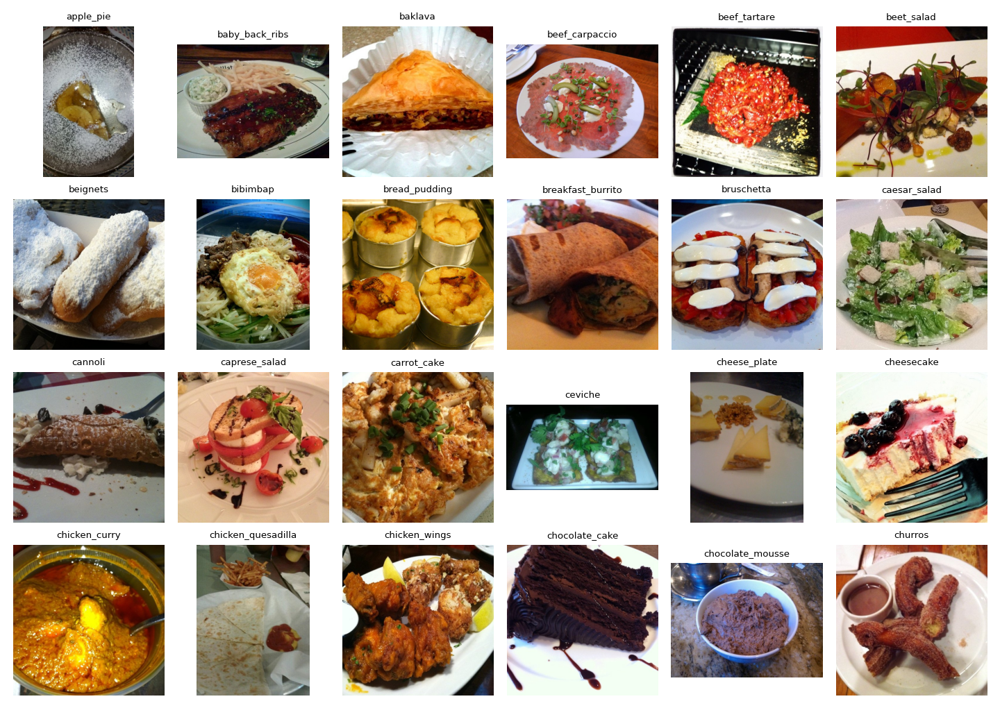
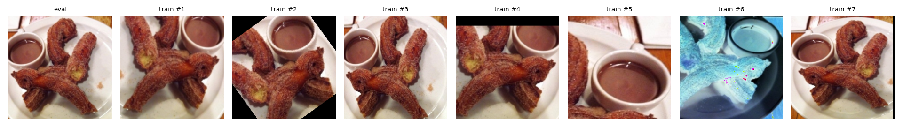
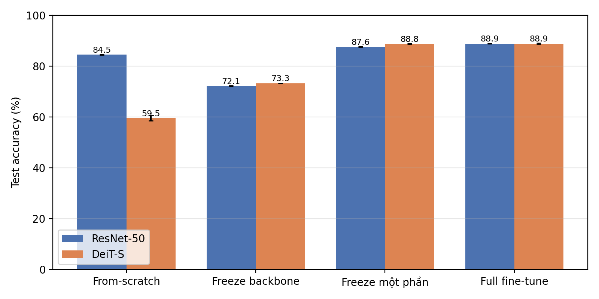
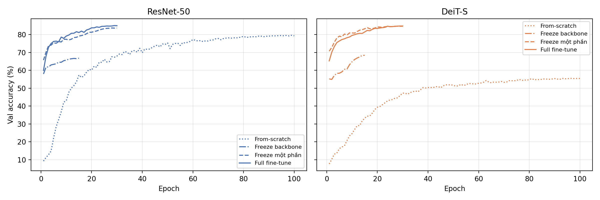
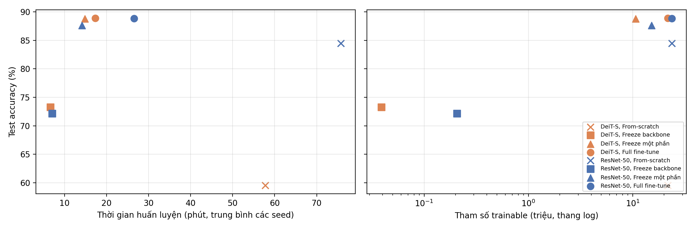
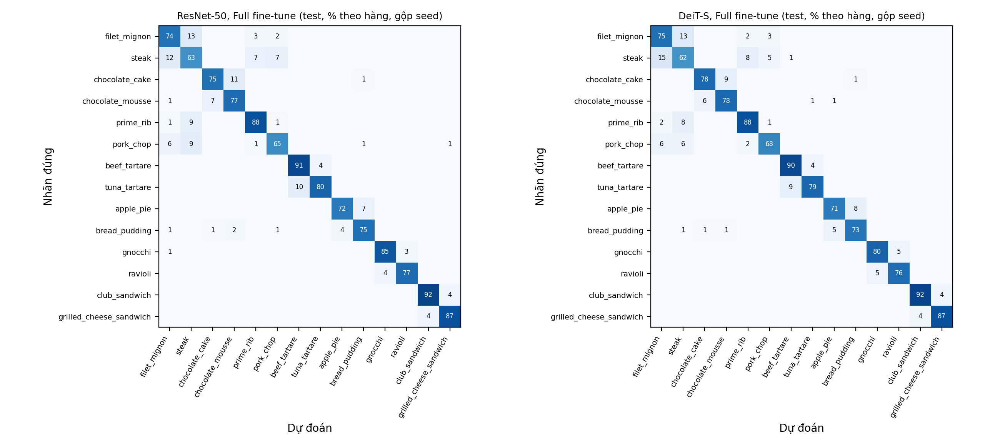
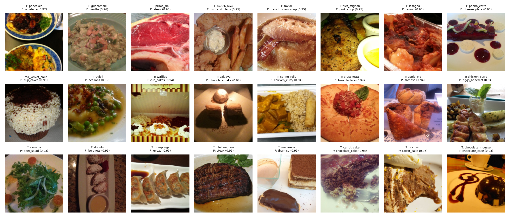

[← Trang chủ](index.html)

## A1: CNN vs Transformer trên Food-101

- **Dataset:** [Food-101](https://data.vision.ee.ethz.ch/cvl/datasets_extra/food-101/) (Bossard et al., ECCV 2014): 101 lớp món ăn, 101,000 ảnh
- **CNN:** ResNet-50 (23.7M tham số, pretrained ImageNet-1k)
- **Transformer:** DeiT-S/16 (21.7M tham số, pretrained ImageNet-1k)
- **Kết quả chính (test, 3 seed):** khi pretrained, full fine-tune của hai model ngang nhau (ResNet-50 88.86%, DeiT-S 88.89%). Khi train from-scratch, DeiT-S chỉ đạt 59.53% so với 84.50% của ResNet-50. Freeze một phần với DeiT-S giữ được 88.80% mà chỉ train 49% tham số. Chi tiết ở mục 4 và 5 bên dưới.
- **Code:** [thư mục A1](https://github.com/anhtr-nguyn/co5085-dl-cv/tree/main/A1)
- **Báo cáo PDF:** *(sẽ cập nhật tại `reports/a1.pdf`; A1.1: dataset + protocol, A1.2: kết quả cuối)*
- **Video demo:** *(chưa có)*

## 1. EDA / Dataset

- Split chính thức: 750 ảnh train + 250 ảnh test mỗi lớp. Ảnh có cạnh dài 512 px. Nhãn train cố ý chưa làm sạch (có nhiễu), tập test đã làm sạch thủ công.
- License: ảnh từ Foodspotting, chỉ dùng trong phạm vi *scientific fair use*; repo không phân phối lại ảnh.
- Lý do chọn: 101 lớp, khó và chi tiết hơn hẳn CIFAR-10; ảnh độ phân giải cao phù hợp backbone pretrained 224×224; nhãn train nhiễu là điều kiện thực tế.

## 2. DataLoader & augmentation

| Tập | Nguồn | Số ảnh | Mỗi lớp |
|---|---|---|---|
| Train | split train chính thức, bỏ phần val | 68,175 | 675 |
| Val | 10% split train, phân tầng theo lớp, seed 912 | 7,575 | 75 |
| Test | split test chính thức | 25,250 | 250 |

- Train: RandomResizedCrop 224 → HorizontalFlip → TrivialAugmentWide → Normalize (ImageNet mean/std). Val/test: Resize 256 → CenterCrop 224.
- Cùng pipeline cho mọi run; label smoothing 0.1.

## 3. Protocol thí nghiệm

| Chế độ | ResNet-50 (trainable) | DeiT-S (trainable) |
|---|---|---|
| From-scratch | toàn bộ (23.71M) | toàn bộ (21.70M) |
| Pretrained, freeze toàn bộ backbone | chỉ head (0.21M) | chỉ head (0.04M) |
| Pretrained, freeze một phần | layer4 + head (15.17M) | block 7–12 + head (10.69M) |
| Pretrained, full fine-tune | toàn bộ (23.71M) | toàn bộ (21.70M) |

- AdamW (weight decay 0.05), warmup 5% + cosine, grad clip 1.0, label smoothing 0.1, drop path 0.1, batch 128, bf16. Epoch: 15 (freeze backbone), 30 (freeze một phần, full fine-tune), 100 (from-scratch).
- Learning rate dò trên val với seed 912. Head-only dùng lịch 15 epoch; freeze một phần và full fine-tune dùng lịch rút gọn 10 epoch. Tổng cộng 26 run sweep ([bảng sweep](https://github.com/anhtr-nguyn/co5085-dl-cv/blob/main/A1/outputs/sweep.md)). LR chọn: head 1e-2 (cả hai model); freeze một phần 1e-2 (ResNet) / 1e-3 (DeiT); full fine-tune 1e-3 (ResNet) / 3e-4 (DeiT). From-scratch không dò LR: cố định 1e-3 (ResNet) và 5e-4 (DeiT).
- Mỗi cấu hình chạy 3 seed (912, 42, 100), tổng 24 run. Kết quả báo cáo mean ± std.
- Metric: top-1/top-5 accuracy, macro-F1, số tham số trainable, thời gian huấn luyện, throughput, peak GPU memory; confusion matrix và các cặp lớp hay nhầm.
- Test chỉ đánh giá một lần với best-val checkpoint.

## 4. Kết quả so sánh

Test Food-101 (25,250 ảnh), mean ± std qua 3 seed. Throughput và memory đo riêng trên một A100 rảnh (batch 128, bf16, chỉ tính GPU; from-scratch có cùng chi phí mỗi bước với full fine-tune).

| Model | Chế độ | Trainable | Test acc (%) | Top-5 (%) | Macro-F1 (%) | Train (ảnh/s) | Peak mem (MB) |
|---|---|---|---|---|---|---|---|
| ResNet-50 | From-scratch | 23.71M (100%) | 84.50 ± 0.16 | 96.14 ± 0.07 | 84.46 ± 0.16 | 1,985 | 5,834 |
| ResNet-50 | Freeze backbone | 0.21M (0.9%) | 72.14 ± 0.12 | 91.91 ± 0.02 | 71.88 ± 0.12 | 6,422 | 891 |
| ResNet-50 | Freeze một phần | 15.17M (64%) | 87.64 ± 0.11 | 97.62 ± 0.08 | 87.62 ± 0.10 | 5,298 | 940 |
| ResNet-50 | Full fine-tune | 23.71M (100%) | **88.86 ± 0.05** | **97.94 ± 0.06** | 88.84 ± 0.04 | 1,985 | 5,834 |
| DeiT-S | From-scratch | 21.70M (100%) | 59.53 ± 0.96 | 80.88 ± 0.50 | 59.22 ± 0.93 | 2,463 | 4,645 |
| DeiT-S | Freeze backbone | 0.04M (0.2%) | 73.28 ± 0.01 | 92.42 ± 0.00 | 73.09 ± 0.01 | 8,284 | 470 |
| DeiT-S | Freeze một phần | 10.69M (49%) | 88.80 ± 0.22 | 97.28 ± 0.09 | 88.79 ± 0.22 | 3,854 | 2,492 |
| DeiT-S | Full fine-tune | 21.70M (100%) | **88.89 ± 0.16** | 97.55 ± 0.02 | **88.86 ± 0.16** | 2,463 | 4,645 |

Inference: ResNet-50 khoảng 6,470 ảnh/s, DeiT-S khoảng 8,400 ảnh/s. Bảng đầy đủ (val acc, best epoch, thời gian thực tế) ở [results.md](https://github.com/anhtr-nguyn/co5085-dl-cv/blob/main/A1/outputs/results.md). Test cao hơn val khoảng 4–5 điểm ở mọi cấu hình, vì val lấy từ split train có nhãn nhiễu còn test đã được làm sạch.

Thời gian huấn luyện thực tế (hình trên, trái) có nhiễu: hai job chạy song song và dùng chung DataLoader trên 32 CPU (khoảng 2,400–2,900 ảnh/s). Head-only và freeze một phần bị giới hạn bởi DataLoader, nên chỉ mất khoảng 7 và 15 phút. Full fine-tune mất 17 phút (DeiT) và 21–38 phút (ResNet), còn from-scratch mất 58 phút (DeiT) và 76 phút (ResNet).

### Phân tích lỗi

- Ở cả 8 cấu hình, cặp nhầm nhiều nhất là **filet_mignon ↔ steak** (12.6–16.7% gộp hai chiều). Các cặp khác lặp lại ở hầu hết cấu hình: chocolate_cake ↔ chocolate_mousse, prime_rib ↔ steak, pork_chop ↔ steak, beef_tartare ↔ tuna_tartare, apple_pie ↔ bread_pudding. Đây là các món cùng màu và kết cấu, khác nhau ở cách cắt hoặc nguyên liệu bên trong.
- steak có F1 thấp nhất ở 7/8 cấu hình: 0.36–0.38 khi freeze backbone, 0.61–0.62 khi full fine-tune. edamame có F1 cao nhất ở cả 8 cấu hình (0.97–1.00).
- Danh sách đầy đủ theo từng cấu hình ở [errors.md](https://github.com/anhtr-nguyn/co5085-dl-cv/blob/main/A1/outputs/errors.md).

Trong các ảnh sai với độ tự tin cao, một số có vẻ là nhãn nhiễu hoặc ảnh có nhiều món (ví dụ nhãn prime_rib nhưng ảnh là miếng thịt sống, model đoán steak). Đây là nhận xét bằng mắt, không đếm định lượng.

## 5. Thảo luận

**ViT cần pretraining khi nào?** Trên khoảng 68k ảnh train (675 ảnh/lớp), DeiT-S from-scratch chỉ đạt 59.53%, thấp hơn ResNet-50 from-scratch 25 điểm (84.50%). Khi có pretrained ImageNet-1k, hai model ngang nhau (88.89% và 88.86%). Pretraining tăng 29.4 điểm cho DeiT-S nhưng chỉ 4.4 điểm cho ResNet-50. Theo đường val acc (seed 912), ResNet-50 đạt 69.9% ở epoch 40 và 79.3% ở epoch 100. DeiT-S chỉ đạt 50.3% ở epoch 40 và 55.4% ở epoch 100. Cả hai đều chững lại ở cuối lịch cosine, nhưng DeiT-S chững ở mức thấp hơn nhiều. Điều này khớp với giải thích quen thuộc: CNN có sẵn inductive bias về tính cục bộ và tịnh tiến, còn ViT phải học cấu trúc không gian từ dữ liệu nên cần dữ liệu lớn hơn nhiều. Ở quy mô dữ liệu này, ViT gần như bắt buộc phải pretrain. Lưu ý: DeiT-S from-scratch chưa được dò LR và chỉ train 100 epoch, không dùng các kỹ thuật riêng của DeiT (Mixup/CutMix, repeated augmentation, distillation, 300 epoch). Vì vậy khoảng cách 25 điểm là kết quả dưới ngân sách này, không phải giới hạn của kiến trúc.

**Khi nào freeze có lợi?**
- *Freeze toàn bộ backbone* rẻ nhất: dưới 1% tham số trainable; train throughput tăng 3.2× (ResNet) và 3.4× (DeiT); peak memory giảm 6.5× và 10×. Đổi lại, accuracy thấp hơn full fine-tune khoảng 16 điểm (72.14% và 73.28%). LR đã bão hòa và std rất nhỏ, nên giới hạn nằm ở đặc trưng ImageNet chứ không ở quá trình tối ưu: Food-101 là bài toán phân loại chi tiết, và ImageNet-1k có ít lớp món ăn. Chế độ này hợp với baseline nhanh, phần cứng rất hạn chế, hoặc khi một backbone phải dùng chung cho nhiều tác vụ.
- *Freeze một phần* là điểm cân bằng tốt nhất. Với DeiT-S, train 6 block cuối (49% tham số) cho 88.80 ± 0.22%, ngang full fine-tune (88.89 ± 0.16%, chênh lệch nằm trong độ lệch chuẩn), với peak memory giảm 46% và throughput tăng 1.56×. Với ResNet-50, chỉ train `layer4` (64% tham số) thấp hơn full fine-tune 1.2 điểm (87.64% và 88.86%, chênh lệch lớn hơn std). Đổi lại, throughput tăng 2.7× và memory giảm 6×, vì phần lớn tính toán của ResNet nằm ở các stage đầu có độ phân giải cao, còn `layer4` chạy ở độ phân giải 7×7. Giả thuyết (chưa kiểm chứng): đặc trưng tầng giữa của ResNet (`layer1–3`, kèm BatchNorm giữ thống kê ImageNet) cần thích nghi với kết cấu món ăn, còn 6 block cuối của DeiT đã có receptive field toàn ảnh nên đủ để thích nghi.
- Kết luận: freeze có lợi khi bị giới hạn bởi compute hoặc memory. Với ViT, freeze nửa đầu gần như không mất accuracy. Khi tài nguyên đủ, full fine-tune vẫn tốt nhất cho cả hai họ.

**CNN hay Transformer?** Khi đã pretrain, hai họ ngang nhau về top-1 và macro-F1. ResNet-50 nhỉnh hơn về top-5 (97.94% và 97.55%), còn DeiT-S nhỉnh hơn khi freeze backbone (+1.1 điểm). DeiT-S nhẹ hơn và có inference nhanh hơn trên A100 với bf16 (khoảng 8,400 so với 6,470 ảnh/s). Khi không có pretrained, CNN tốt hơn hẳn. Các cặp lớp hay nhầm gần như giống nhau ở mọi cấu hình, nên phần lỗi còn lại chủ yếu đến từ bản chất dữ liệu (món gần giống nhau, nhãn train nhiễu) chứ không phải từ kiến trúc.

**Hạn chế.**
- Partial và full fine-tune dò LR với lịch 10 epoch, ngắn hơn lịch thật 30 epoch.
- Ba cấu hình chọn LR ở biên lưới, nhưng nấc cuối chỉ tăng 0.1–0.3 điểm.
- From-scratch không dò LR.
- Chỉ có 3 seed và một split train/val. Seed chỉ thay đổi khởi tạo và thứ tự batch.
- Thời gian thực tế bị nhiễu do chạy song song; so sánh chi phí nên dựa vào throughput đo riêng.
