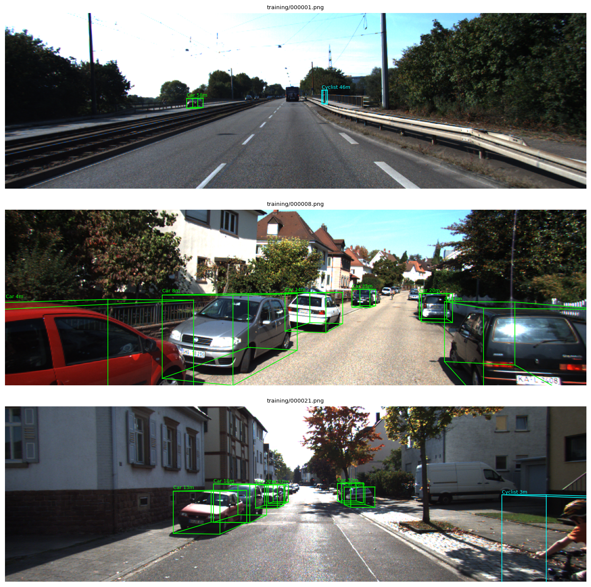
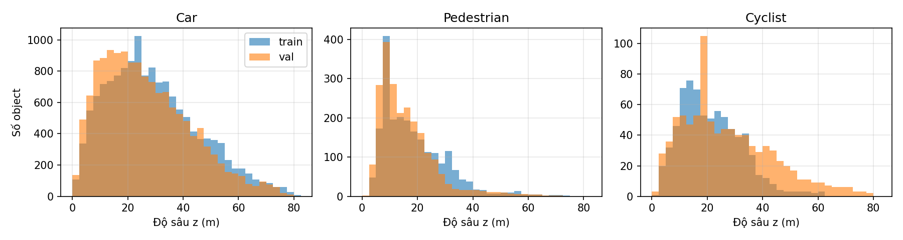
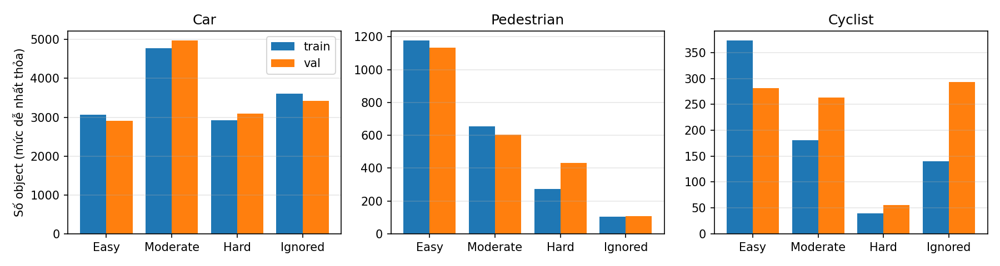
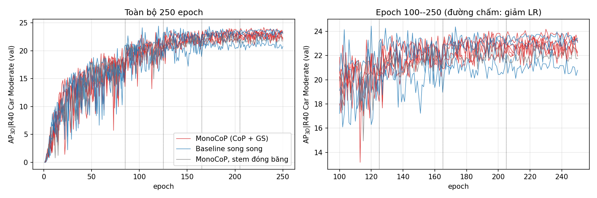
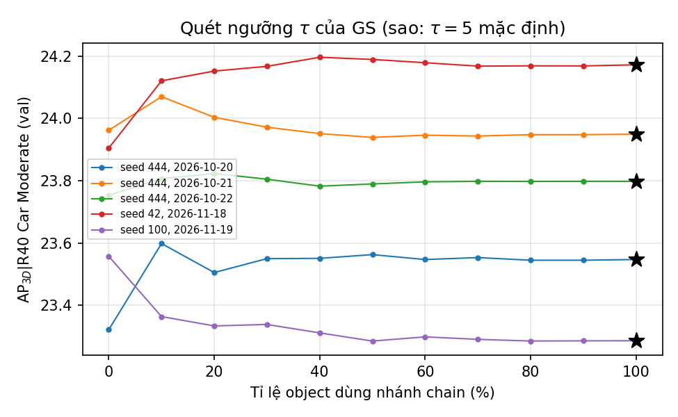
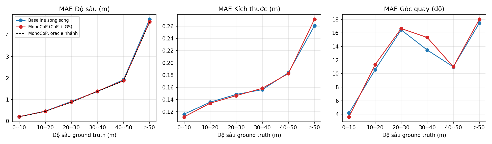
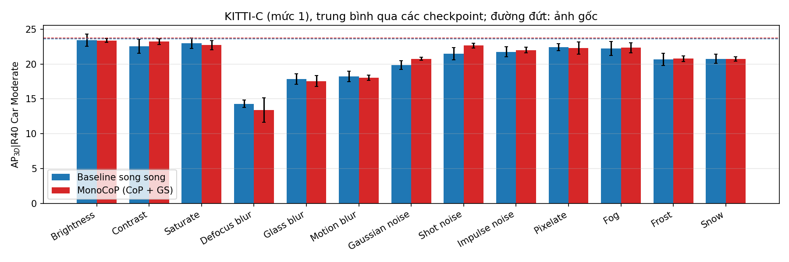

[← Trang chủ](index.html)

## A2: Monocular 3D Object Detection trên KITTI

- **Chủ đề:** phát hiện đối tượng 3D từ một ảnh RGB (monocular 3D object detection). Thuộc nhóm *phát hiện đối tượng* trong đề.
- **Paper phân tích:** Zhihao Zhang, Abhinav Kumar, Girish Chandar Ganesan, Xiaoming Liu. *Unleashing the Power of Chain-of-Prediction for Monocular 3D Object Detection*. CVPR 2026 (Highlight). [arXiv:2505.04594](https://arxiv.org/abs/2505.04594) · [code chính thức](https://github.com/alanzhangcs/MonoCoP)
- **Dataset:** [KITTI 3D Object Detection](https://www.cvlibs.net/datasets/kitti/eval_object.php?obj_benchmark=3d) (Geiger et al., CVPR 2012), split train/val 3,712/3,769
- **Metric chính:** AP3D\|R40 lớp Car, IoU 0.7, mức Moderate
- **Kết quả chính:** tái hiện MonoCoP đạt median **23.80** (5 run) so với 23.98 trong paper. Baseline dự đoán song song trên cùng code và recipe đạt median **23.89** (3 seed), nên CoP + GS không cải thiện vượt dao động giữa các run, khác với mức +2.86 trong ablation của paper. GS với ngưỡng mặc định luôn chọn nhánh chain và chỉ chọn đúng nhánh tốt hơn cho 49.4% xe (paper: 82.18%). Chi tiết ở mục 4 và 5.
- **Code:** [thư mục A2](https://github.com/anhtr-nguyn/co5085-dl-cv/tree/main/A2)
- **Báo cáo PDF:** [reports/a2.pdf](reports/a2.pdf)
- **Video demo:** *(chưa có)*

## 1. Bài toán và tập dữ liệu (EDA)

Input là một ảnh RGB cùng ma trận chiếu của camera. Với mỗi object, model dự đoán lớp, box 2D, và box 3D trong hệ tọa độ camera: tâm, kích thước (h, w, l) và góc quay quanh trục đứng. Khó nhất là ước lượng độ sâu, vì một xe nhỏ ở gần và một xe lớn ở xa có thể trông giống nhau trên ảnh.

| Tập | Số ảnh | Car | Pedestrian | Cyclist | Vai trò |
|---|---|---|---|---|---|
| train | 3,712 | 14,357 | 2,207 | 734 | huấn luyện |
| val | 3,769 | 14,385 | 2,280 | 893 | chọn checkpoint và báo cáo (như paper) |
| test | 7,518 | – | – | – | nhãn ẩn, không dùng |

- Ảnh camera màu trái, khoảng 1242×375 px (4 kích thước do hiệu chỉnh camera theo ngày). Dùng nhãn 3D và calib, không dùng LiDAR. License CC BY-NC-SA 3.0; repo không phân phối lại ảnh.
- Car chiếm đa số (khoảng 4 xe/ảnh), nhiều gấp 6.5 lần Pedestrian và 20 lần Cyclist. Vì vậy A2 tập trung vào lớp Car.
- Độ sâu của Car trong train có median 27.0 m và p95 60.5 m; 24.6% số xe ở xa từ 40 m trở lên.
- Mức khó theo KITTI, dựa trên chiều cao box 2D, mức che khuất và mức bị cắt: Easy (≥ 40 px, không bị che, cắt ≤ 15%), Moderate (≥ 25 px, che một phần, cắt ≤ 30%), Hard (≥ 25 px, che nhiều, cắt ≤ 50%). Xếp mỗi xe trong train vào mức dễ nhất mà nó thỏa: Easy 3,064, Moderate 4,770, Hard 2,919, và 3,604 xe không thỏa mức nào nên bị bỏ qua khi tính AP.

## 2. Dataset, DataLoader, augmentation

Giữ nguyên pipeline dữ liệu của MonoCoP để kết quả so sánh được với paper:
- Ảnh affine-transform về 1280×384, chuẩn hóa theo mean/std của ImageNet.
- Photometric distortion (độ sáng, tương phản, bão hòa, sắc độ).
- Lật ngang với xác suất 0.5; nhãn 3D và calib được cập nhật theo.
- Random crop với xác suất 0.5 (scale 1 ± 0.05, shift ±10%); độ sâu được nhân với tỉ lệ scale.
- Mixup 3D với xác suất 0.3: trộn 50/50 với một ảnh train có cùng ma trận nội tại, gộp nhãn.
- Khi train chỉ giữ Car, bỏ object không thuộc mức khó nào hoặc có độ sâu dưới 2 m.
- Batch 16, 4 worker. Val chỉ resize, không augmentation.

## 3. Phân tích paper

- **Ý tưởng:** độ sâu, kích thước và góc quay liên hệ với nhau qua phép chiếu (paper đo trên MonoDETR: sai số độ sâu tương quan với sai số kích thước r = 0.35, với sai số góc r = 0.11), nên không nên dự đoán độc lập. Dự đoán tuần tự trên output thì dễ tích lũy lỗi, nhất là với object bị che.
- **Chain-of-Prediction (CoP):** từ object query, ba MLP hai lớp tạo đặc trưng theo chuỗi size → angle → depth, mỗi bước có kết nối residual với bước trước; chuỗi nằm ở mức đặc trưng trong một lần forward.
- **Uncertainty-Guided Selector (GS):** độ sâu theo phân phối Laplace có dự đoán σ; với mỗi object, dùng nhánh chain nếu độ tin cậy 1/σ đủ cao, ngược lại dùng nhánh song song.
- **Nền:** MonoDGP/MonoDETR gồm ResNet-50, head phân đoạn vùng, depth predictor, Transformer kiểu deformable DETR với 50 query × 11 nhóm. Độ sâu = độ sâu hình học f·h3D/h2D + phần bù hồi quy. Train 250 epoch.
- **Kết quả paper (KITTI val, Car, AP3D\|R40 IoU 0.7):** 32.06 / 23.98 / 20.64, so với 30.76 / 22.34 / 19.02 của MonoDGP. Ablation: baseline 21.12 → + CoP 23.64 → + GS 23.98; GS chọn đúng nhánh cho 82.18% object.
- **Đối chiếu với code chính thức:** chỉ độ sâu có hai nhánh (kích thước và góc luôn lấy từ chuỗi); khi train, nhánh được chọn **ngẫu nhiên** theo nhóm query, không theo σ; khi suy luận, chain được chọn nếu log σ < 5, một ngưỡng mà mọi dự đoán đều thỏa; checkpoint best được chọn trên chính tập val dùng để báo cáo.
- **Hạn chế:**
  - Baseline 21.12 của ablation là MonoDGP do tác giả chạy lại (theo phụ lục bản arXiv; bản CVPR ghi cùng số cho MonoDETR), không phải MonoCoP bỏ CoP + GS trên cùng code.
  - Paper không báo cáo độ dao động giữa các run, trong khi nhiều chênh lệch ở ablation chỉ vài phần mười điểm.
  - Tác giả chỉ nêu một hạn chế: chưa xử lý thay đổi tham số camera.

## 4. Pipeline, huấn luyện, so sánh phương pháp

Dùng code chính thức của MonoCoP (commit `7d39324`) kèm vài bản vá build cho CUDA 12.1/A100 ([`A2/monocop/monocop.patch`](https://github.com/anhtr-nguyn/co5085-dl-cv/blob/main/A2/monocop/monocop.patch)). Mọi run dùng cùng recipe: AdamW lr 2e-4, weight decay 1e-4, giảm một nửa ở epoch 85/125/165/205, 250 epoch, batch 16, một A100 mỗi run (khoảng 14.8 giờ/run).

| # | Biến thể | Mô tả | Tham số | Run |
|---|---|---|---|---|
| 1 | MonoCoP (CoP + GS) | cấu hình `monocop_car.yaml` của tác giả | 42.53M | seed 444 (×3), 42, 100 |
| 2 | Baseline song song | thêm cờ `chain_prediction: False`: size, angle, depth dự đoán độc lập từ query, không CoP, không GS | 41.15M | seed 444, 42, 100 |
| 3 | Chọn nhánh khi suy luận | trên checkpoint của biến thể 1: luôn chain, luôn parallel, GS, chọn nhánh có σ thấp hơn, quét ngưỡng | – | không train lại |
| 4 | *(mở rộng)* | MAE theo khoảng cách; KITTI-C (13 loại nhiễu); chi phí | – | trên checkpoint best |

- Op deformable attention cộng dồn gradient bằng `atomicAdd`, nên ba run cùng seed 444 vẫn cho kết quả khác nhau (23.55 / 23.95 / 23.80); chúng được xem như ba lần lặp độc lập.
- Run MonoCoP đầu tiên (01/10, 23.06) giữ lớp stem của backbone đóng băng như code gốc, khác các run còn lại, nên được báo cáo riêng.
- Như paper, báo cáo checkpoint best trên val; báo cáo thêm epoch 250 vì best được chọn trên chính tập báo cáo.

## 5. Kết quả, thảo luận, hạn chế

KITTI val, Car, AP\|R40 IoU 0.7, trung bình ± độ lệch chuẩn qua các run. Bảng đầy đủ (từng run, IoU 0.5, APBEV) ở [results.md](https://github.com/anhtr-nguyn/co5085-dl-cv/blob/main/A2/outputs/results.md).

| Biến thể | Run | Checkpoint | AP3D Easy | AP3D Mod. | AP3D Hard | APBEV Mod. | AP3D Mod. median |
|---|---|---|---|---|---|---|---|
| Baseline song song | 3 | best | 32.33 ± 2.13 | 23.60 ± 1.00 | 20.32 ± 0.78 | 29.88 ± 1.34 | 23.89 |
| Baseline song song | 3 | epoch 250 | 30.14 ± 2.76 | 22.43 ± 1.44 | 19.65 ± 1.00 | 29.05 ± 0.90 | 23.08 |
| MonoCoP (CoP + GS) | 5 | best | 32.17 ± 1.14 | **23.75 ± 0.35** | 20.49 ± 0.22 | 29.69 ± 0.16 | 23.80 |
| MonoCoP (CoP + GS) | 5 | epoch 250 | 30.58 ± 1.18 | 22.56 ± 0.59 | 19.76 ± 0.25 | 29.16 ± 0.31 | 22.29 |
| *Paper: MonoCoP* | 5 | best (median) | 32.06 | 23.98 | 20.64 | – | 23.98 |

**Chọn nhánh khi suy luận** (5 checkpoint MonoCoP):

| Quy tắc | Tỉ lệ dùng chain | AP3D Mod. |
|---|---|---|
| GS, τ = 5 (mặc định) | 100% | 23.75 ± 0.35 |
| Luôn chain | 100% | 23.75 ± 0.35 |
| Luôn parallel | 0% | 23.70 ± 0.26 |
| Nhánh có σ thấp hơn | 47% | 23.73 ± 0.25 |
| Quét τ (10–90% dùng chain) | 10–90% | 23.75–23.79 |

**Sai số theo khoảng cách** (MAE trên các xe ghép được với ground truth, IoU 2D ≥ 0.5):

| Sai số | Mô hình | 0–10 m | 10–20 | 20–30 | 30–40 | 40–50 | ≥ 50 m | Tất cả |
|---|---|---|---|---|---|---|---|---|
| Độ sâu (m) | Baseline | 0.20 | 0.46 | 0.91 | 1.37 | 1.92 | 4.73 | 0.93 |
| Độ sâu (m) | MonoCoP | 0.20 | 0.45 | 0.89 | 1.39 | 1.88 | 4.62 | 0.92 |
| Kích thước (m) | Baseline | 0.12 | 0.14 | 0.15 | 0.16 | 0.18 | 0.26 | 0.15 |
| Kích thước (m) | MonoCoP | 0.11 | 0.13 | 0.15 | 0.16 | 0.18 | 0.27 | 0.15 |

**KITTI-C** (mức 1): các loại mờ gây hại nhiều nhất (defocus blur: AP3D Moderate 14.30 với baseline, 13.41 với MonoCoP, so với khoảng 23.6–23.8 trên ảnh gốc); mức giảm trung bình qua 13 loại nhiễu như nhau ở hai biến thể (khoảng 12.5%).

**Chi phí:** MonoCoP 42.53M tham số, 26.6 ms/ảnh (37.6 FPS, batch 1, fp32, A100); baseline 41.15M tham số, 25.4 ms/ảnh (39.4 FPS).

### Thảo luận

- **Tái hiện được con số chính:** median 23.80 so với 23.98 (Easy 32.05 so với 32.06, Hard 20.53 so với 20.64), số tham số khớp (42.53M so với 42.50M).
- **CoP + GS không cải thiện vượt dao động giữa các run.** Baseline song song cùng code: median 23.89 (cao hơn MonoCoP 0.09), trung bình 23.60 (thấp hơn 0.15); các seed baseline dao động 22.49–24.44. Baseline này cao hơn baseline 21.12 của paper khoảng 2.8 điểm, nên phần lớn mức +2.86 trong paper nhiều khả năng đến từ khác biệt code hoặc dao động, không từ các head 3D. Một lý do có thể: độ sâu vốn đã tính từ chiều cao 3D (f·h3D/h2D), nên baseline song song đã khai thác ràng buộc kích thước–độ sâu.
- **GS không hoạt động như mô tả:** phân vị 99% của log σ nhánh chain chỉ 0.85–1.02 ở cả 5 checkpoint, nên với ngưỡng 5 GS luôn chọn chain. Hai nhánh độ sâu cho sai số gần như bằng nhau (MAE 0.924 m), GS chọn đúng nhánh tốt hơn cho 49.4% xe, và ngay cả oracle cũng chỉ giảm MAE xuống 0.911 m.
- **Chọn checkpoint trên val** làm số best cao hơn epoch 250 trung bình 1.18 điểm; ở epoch 250, thứ hạng hai biến thể đổi theo thống kê (MonoCoP cao hơn theo trung bình, thấp hơn theo median).
- **Sai số góc** lớn chủ yếu do khoảng 5% xe bị dự đoán lật ngược 180°, chiếm 72–76% tổng sai số góc.

### Hạn chế

- 5 run MonoCoP (3 cùng seed) và 3 run baseline, không đủ để phát hiện chênh lệch cỡ 0.3–0.5 điểm.
- Chọn checkpoint trên val như paper; không có tập val riêng.
- Chỉ lớp Car, chỉ KITTI; không nộp lên server test.
- Không chạy code MonoDGP gốc, và không train lại MonoCoP với GS dùng σ khi train như mô tả trong paper.
- MAE chỉ tính trên các xe phát hiện được (tỉ lệ ghép giảm còn 44–49% từ 50 m trở lên); KITTI-C chỉ ở mức nhiễu 1.
