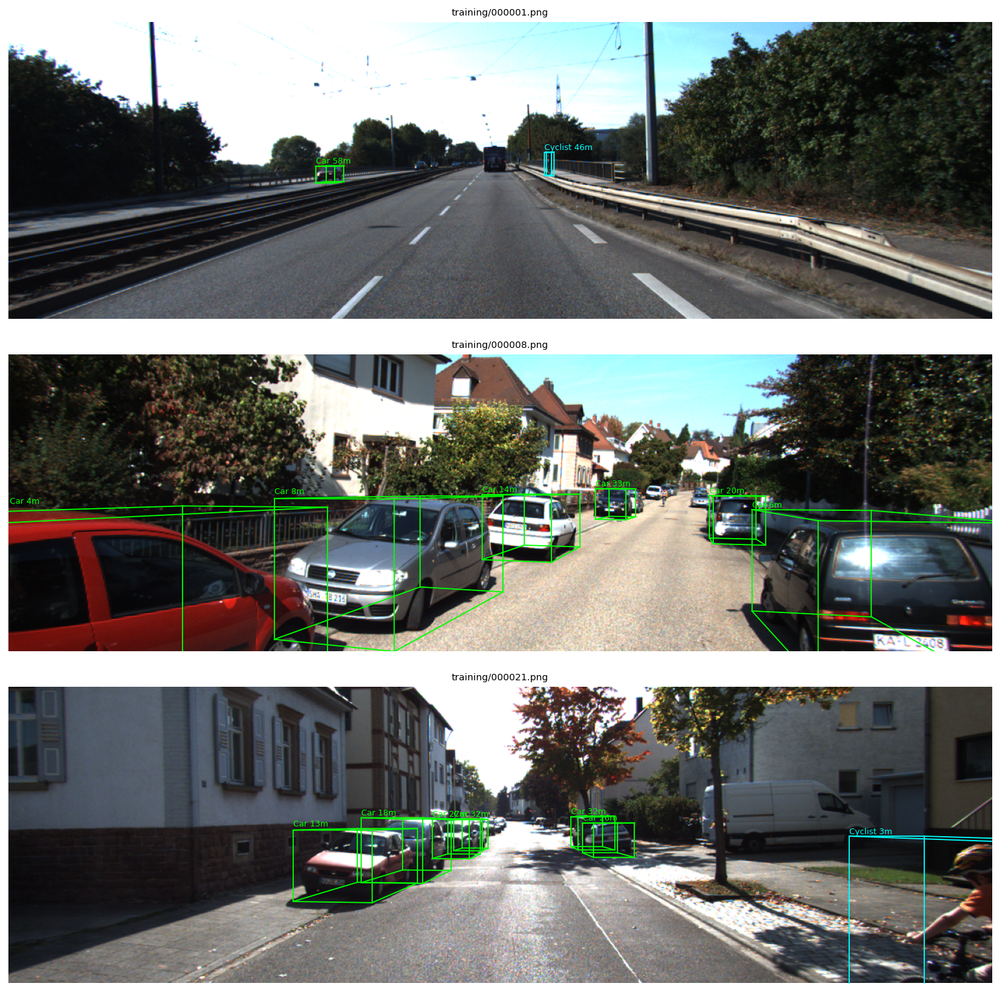
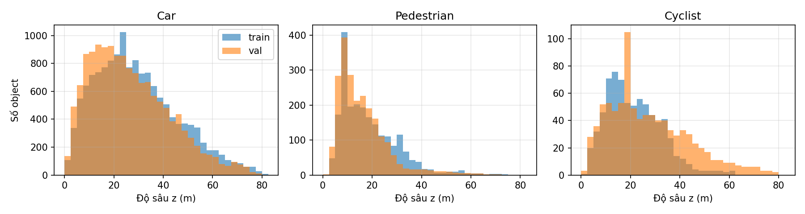
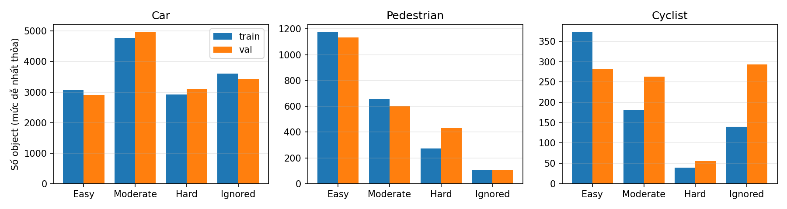

[← Trang chủ](index.html)

## A2: Monocular 3D Object Detection trên KITTI

- **Chủ đề:** phát hiện đối tượng 3D từ một ảnh RGB (monocular 3D object detection). Thuộc nhóm *phát hiện đối tượng* trong đề.
- **Paper phân tích:** Zhihao Zhang, Abhinav Kumar, Girish Chandar Ganesan, Xiaoming Liu. *Unleashing the Power of Chain-of-Prediction for Monocular 3D Object Detection*. CVPR 2026 (Highlight). [arXiv:2505.04594](https://arxiv.org/abs/2505.04594) · [code chính thức](https://github.com/alanzhangcs/MonoCoP)
- **Dataset:** [KITTI 3D Object Detection](https://www.cvlibs.net/datasets/kitti/eval_object.php?obj_benchmark=3d) (Geiger et al., CVPR 2012), split train/val 3,712/3,769
- **Metric chính:** AP3D\|R40 lớp Car, IoU 0.7, mức Moderate
- **Code:** [thư mục A2](https://github.com/anhtr-nguyn/co5085-dl-cv/tree/main/A2)
- **Báo cáo PDF:** *(sẽ cập nhật tại `reports/a2.pdf`)*
- **Video demo:** *(sẽ cập nhật ở A2.2)*

## 1. Bài toán và tập dữ liệu (EDA)

Input là một ảnh RGB cùng ma trận chiếu của camera. Với mỗi object, model dự đoán lớp, box 2D, và box 3D trong hệ tọa độ camera: tâm, kích thước (h, w, l) và góc quay quanh trục đứng. Khó nhất là ước lượng độ sâu, vì một xe nhỏ ở gần và một xe lớn ở xa có thể trông giống nhau trên ảnh.

| Tập | Số ảnh | Car | Pedestrian | Cyclist | Vai trò |
|---|---|---|---|---|---|
| train | 3,712 | 14,357 | 2,207 | 734 | huấn luyện |
| val | 3,769 | 14,385 | 2,280 | 893 | chọn checkpoint và báo cáo (như paper) |
| test | 7,518 | – | – | – | nhãn ẩn, không dùng |

- Ảnh camera màu trái, khoảng 1242×375 px (4 kích thước do hiệu chỉnh camera theo ngày). Dùng nhãn 3D và calib, không dùng LiDAR. License CC BY-NC-SA 3.0; repo không phân phối lại ảnh.
- Car chiếm đa số (khoảng 4 xe/ảnh), nhiều gấp 6.5 lần Pedestrian và 20 lần Cyclist. Vì vậy A2 tập trung vào lớp Car.
- Độ sâu của Car trong train có median 27.0 m và p95 60.5 m; 24.6% số xe ở xa từ 40 m trở lên.
- Mức khó theo KITTI, dựa trên chiều cao box 2D, mức che khuất và mức bị cắt: Easy (≥ 40 px, không bị che, cắt ≤ 15%), Moderate (≥ 25 px, che một phần, cắt ≤ 30%), Hard (≥ 25 px, che nhiều, cắt ≤ 50%). Xếp mỗi xe trong train vào mức dễ nhất mà nó thỏa: Easy 3,064, Moderate 4,770, Hard 2,919, và 3,604 xe không thỏa mức nào nên bị bỏ qua khi tính AP.

## 2. Dataset, DataLoader, augmentation

Giữ nguyên pipeline dữ liệu của MonoCoP:
- Ảnh affine-transform về 1280×384, chuẩn hóa theo mean/std của ImageNet.
- Photometric distortion (độ sáng, tương phản, bão hòa, sắc độ).
- Lật ngang với xác suất 0.5; nhãn 3D và calib được cập nhật theo.
- Random crop với xác suất 0.5 (scale 1 ± 0.05, shift ±10%); độ sâu được nhân với tỉ lệ scale.
- Mixup 3D với xác suất 0.3.
- Batch 16. Val chỉ resize, không augmentation.

## 3. Phân tích paper

*(Tóm tắt sơ bộ; phân tích đầy đủ về phương pháp, thí nghiệm và hạn chế ở A2.2.)*

- **Ý tưởng:** độ sâu, kích thước và góc quay liên hệ với nhau qua phép chiếu, nên không nên dự đoán độc lập. Tuy vậy, dự đoán tuần tự trên output dễ tích lũy lỗi, nhất là với object bị che.
- **Chain-of-Prediction (CoP):** từ object query, ba MLP nhỏ học đặc trưng theo chuỗi size → angle → depth, mỗi bước có kết nối residual với bước trước.
- **Uncertainty-Guided Selector (GS):** với mỗi object, nếu uncertainty độ sâu của nhánh chain đủ thấp thì dùng nhánh chain, ngược lại dùng nhánh song song.
- **Nền:** kiến trúc MonoDGP/MonoDETR gồm ResNet-50, depth predictor và Transformer kiểu deformable DETR. Train 250 epoch.
- **Kết quả paper (KITTI val, Car, AP3D\|R40 IoU 0.7):** Easy/Moderate/Hard 32.06 / 23.98 / 20.64, so với 30.76 / 22.34 / 19.02 của MonoDGP. Trong ablation, Moderate tăng từ 21.12 (baseline) lên 23.64 khi thêm CoP, và lên 23.98 khi thêm GS.
- **Điểm sẽ kiểm chứng:** chọn nhánh khi train là ngẫu nhiên, không theo uncertainty; chỉ độ sâu có hai nhánh; checkpoint được chọn trên chính tập val dùng để báo cáo.

## 4. Pipeline, huấn luyện, so sánh phương pháp (kế hoạch A2.2)

Dùng code chính thức của MonoCoP, train và đánh giá trên A100 với cấu hình Car (`monocop_car.yaml`).

| # | Biến thể | Mục đích |
|---|---|---|
| 1 | MonoCoP đầy đủ (CoP + GS) | tái hiện kết quả paper, nhiều seed, báo cáo median |
| 2 | Baseline dự đoán song song (không CoP, không GS) | đo đóng góp của CoP + GS, cùng recipe |
| 3 | Chọn nhánh khi suy luận: luôn chain, luôn parallel, GS, quét ngưỡng | kiểm tra luận điểm của GS mà không cần train lại |
| 4 | *(mở rộng)* MAE theo khoảng cách; độ bền trên KITTI-C | phân tích lỗi, cross-domain |

Metric phụ: AP3D và APBEV ở cả ba mức với IoU 0.7 và 0.5, MAE của độ sâu/kích thước/góc theo khoảng cách, số tham số, thời gian train, FPS.

Chạy thử biến thể 1 (4 run, khoảng 14.7 giờ/run trên một A100): best checkpoint đạt AP3D Car Moderate **23.06–23.95**, so với 23.98 trong paper. Đây là kết quả sơ bộ; số liệu cuối sẽ có ở A2.2.

## 5. Kết quả, thảo luận, hạn chế

*(A2.2 – 16/11/2026)*
