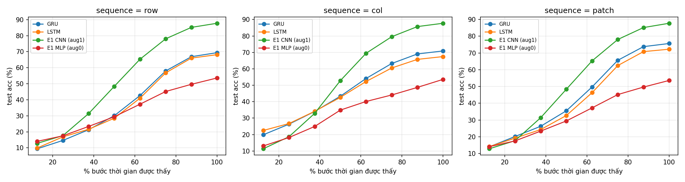

[← Trang chủ](index.html)

## E1–E3: Bài tập nền tảng

- **Dataset dùng chung:** CIFAR-10 (10 lớp, ảnh màu 32×32). Split cố định (`split_seed=912`): train 40,000 / val 10,000 / test 10,000 (test set gốc, chỉ dùng một lần ở cuối).
- **Code:** [E1](https://github.com/anhtr-nguyn/co5085-dl-cv/tree/main/E1) · [E2](https://github.com/anhtr-nguyn/co5085-dl-cv/tree/main/E2) · [E3](https://github.com/anhtr-nguyn/co5085-dl-cv/tree/main/E3)
- **Báo cáo PDF chung:** [reports/exercises.pdf](reports/exercises.pdf) *(gồm E1, E2, E3)*

| Bài | Nội dung | Trạng thái | Hạn |
|---|---|---|---|
| E1 | Softmax / MLP / CNN | Hoàn thành | 02/11/2026 |
| E2 | MSA tự viết vs PyTorch, tokenization | Hoàn thành | 02/11/2026 |
| E3 | LSTM / GRU | Hoàn thành | 09/11/2026 |

## E1

Softmax, MLP và CNN trên ảnh CIFAR-10, training loop tự viết. Adam lr 1e-3, 100 epoch, batch 128, 5 seed (912, 42, 100, 200, 300), mỗi model chạy có và không augmentation (RandomCrop + Flip). Chi tiết: [E1/README.md](https://github.com/anhtr-nguyn/co5085-dl-cv/blob/main/E1/README.md).

| Model | Params | Test acc, không aug (%) | Test acc, có aug (%) |
|---|---|---|---|
| Softmax | 30,730 | 37.36 ± 0.07 | 35.28 ± 0.11 |
| MLP | 9,050,378 | 53.60 ± 0.41 | 49.84 ± 0.30 |
| CNN | 1,558,026 | 83.58 ± 0.25 | 87.75 ± 0.16 |

- CNN vượt xa hai model trên vector flatten dù ít tham số hơn MLP gần 6 lần.
- Augmentation chỉ có lợi cho CNN (+4.2 điểm); với MLP và softmax lại làm giảm accuracy vì model trên vector flatten không bất biến với dịch chuyển.
- Gộp cả hai chiều, cặp lớp nhầm nhiều nhất ở mọi model (không aug) là cat ↔ dog; riêng softmax, nhầm một chiều lớn nhất là deer → frog.

## E2

MSA tự viết (Linear, nhân ma trận, softmax, ghép head) đối chiếu với `nn.MultiheadAttention`, trong một ViT nông (d=128, 4 khối Pre-LN, token CLS, positional embedding) để phân loại CIFAR-10; so sánh ba cách lấy token: patch 4×4, hàng (row), CNN-stem. AdamW + warmup/cosine, 100 epoch, có augmentation, 5 seed. Chi tiết: [E2/README.md](https://github.com/anhtr-nguyn/co5085-dl-cv/blob/main/E2/README.md).

| Tokenizer | #Token | Params | Test acc, MSA tự viết (%) | Test acc, MSA PyTorch (%) | Peak mem train, tự viết / PyTorch (MB) |
|---|---|---|---|---|---|
| Patch 4×4 | 64 | 546,186 | 80.37 ± 0.59 | 79.93 ± 0.28 | 324 / 267 |
| Row | 32 | 548,234 | 71.85 ± 0.30 | 72.00 ± 0.51 | 163 / 152 |
| CNN-stem | 64 | 691,082 | 85.42 ± 0.33 | 85.47 ± 0.21 | 463 / 406 |

- MSA tự viết và PyTorch cho accuracy tương đương (chênh lệch trung bình ≤ 0.44 điểm, cùng cỡ độ lệch chuẩn giữa các seed và đổi dấu theo seed) và thời gian một bước train gần như bằng nhau; bản PyTorch ít bộ nhớ hơn và inference nhanh hơn 12–32% nhờ kernel attention hợp nhất.
- CNN-stem > patch > row: inductive bias cục bộ của convolution giúp ViT nhỏ học tốt hơn trên 40k ảnh; row mất cấu trúc theo chiều ngang.
- ViT tốt nhất (85.5%) vẫn thua CNN của E1 (87.75%); tăng model patch lên 3.2M tham số (200 epoch, 1 seed) chỉ đạt 81.9%.

## E3

`nn.LSTM` / `nn.GRU` (2 tầng, hidden 256, phân loại từ hidden state ở bước cuối) trên ảnh CIFAR-10 dạng chuỗi theo hàng (32 bước), cột (32 bước) và patch 4×4 (64 bước). AdamW + warmup/cosine, 100 epoch, có augmentation, 5 seed, cùng split với E1. Chi tiết: [E3/README.md](https://github.com/anhtr-nguyn/co5085-dl-cv/blob/main/E3/README.md).

| Model | Params | Row (%) | Col (%) | Patch 4×4 (%) |
|---|---|---|---|---|
| LSTM | 842K–891K | 68.15 ± 0.59 | 67.47 ± 0.09 | 72.27 ± 0.31 |
| GRU | 632K–669K | 69.40 ± 0.31 | 70.90 ± 0.32 | 75.66 ± 0.42 |
| E1 MLP (baseline) | 9.05M | 53.60 ± 0.41 | | |
| E1 CNN (baseline) | 1.56M | 87.75 ± 0.16 | | |

Phép thử thứ tự trên test, chuỗi theo hàng (test acc %):

| Model | Đủ chuỗi | Prefix 50% | Đảo ngược | Xáo trộn |
|---|---|---|---|---|
| GRU | 69.40 | 30.08 | 30.82 | 25.74 |
| LSTM | 68.15 | 28.49 | 30.69 | 27.15 |
| E1 CNN | 87.75 | 48.40 | 39.47 | 24.77 |
| E1 MLP | 53.60 | 29.44 | 25.32 | 27.05 |

- GRU tốt hơn LSTM ở cả 3 cách biểu diễn dù ít hơn 25% tham số; biểu diễn patch tốt nhất (75.7%).
- Mọi RNN thua CNN 12–20 điểm nhưng hơn MLP 14–22 điểm với số tham số ít hơn 10–14 lần.
- Accuracy của RNN tăng dần theo số bước đã đọc, và sụt mạnh khi đảo ngược hoặc xáo trộn thứ tự hàng/patch: RNN học được trình tự có hướng. Với chuỗi theo cột, đảo ngược gần như không ảnh hưởng vì augmentation lật ngang đã dạy model đọc theo cả hai chiều.
